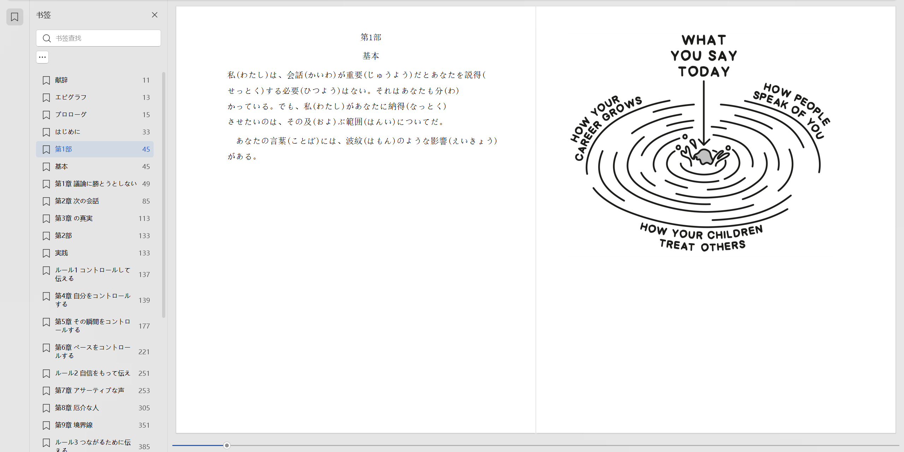

# booktrans

把一本英文 EPUB 翻成**中文版**和**日文版（汉字全部标振假名）**，原书的排版、图片、脚注跳转、目录一并保住。

Windows 上双击就能用。不追求"机翻一遍能看"，追求的是**能拿去读、能拿去打印**的那一档。

> English readers: see [README.en.md](README.en.md).



<p align="center"><sub>
日文版在阅读器里的样子：左边目录整体翻成日文（章节页码照旧可跳），正文段落一一对应、图片位置不变。<br>
假名按 <code>&lt;ruby&gt;</code> 标注；这个阅读器不支持 ruby，所以显示成 <code>私（わたし）</code> 的降级形式<br>
——支持 ruby 的阅读器会把假名排在汉字正上方。截图中的书籍内容版权归原作者，仅用于演示版式与注音。
</sub></p>

---

## 它跟别的工具有什么不一样

翻外文书这件事，现成方案已经不少：`bilingual_book_maker`、Calibre 的各种翻译插件、给日文加假名的 `epub_furigana` —— 各自都做得不错。这个项目的差异只有一个：**把"格式保真"当成一等需求，而不是翻译的副产品。**

具体表现在三件别人容易丢的事上：

| | 常见做法 | 这个工具 |
|---|---|---|
| 脚注/索引内链 | 整段替换，`<a href>` 一起没了，读到最后发现跳不动 | 锚点与链接**逐条迁移**，成品自带断链校验 |
| 行内样式 | 只认 `.italic` 这类固定类名，换个出版社就整本丢斜体 | **读原书的 CSS 判断**：声明了 `font-style:italic` 就是斜体，类名叫什么无所谓 |
| 诗歌 / 代码 | `<br>` 压成空格、`<pre>` 缩进被抹平 | 换行与缩进**一个字符都不动** |
| 日文假名 | 要么不标，要么整词标成一坨 `古い(ふるい)` | 逐汉字标，送り仮名留在外面：`古(ふる)い`、`擦(す)り切(き)れた` |
| 目录 | 只处理 EPUB2 的 `toc.ncx`，EPUB3 的书目录整页英文 | `nav.xhtml` 与 `toc.ncx` 都翻，且与正文用词一致 |

---

## 特性

- **段落级对齐翻译**：不合并、不拆段，一段原文对应一段译文
- **默认不碰版式**：class、首字下沉、分页符、图片位置原样保留；不做双语对照，不加译者注
- **目录一起翻**：EPUB3 `nav.xhtml` + EPUB2 `toc.ncx`，条目与正文去重后只译一次
- **断点续跑**：按段落存 SQLite 缓存，断了重跑不重复计费
- **自带校验**：XML 合法性、断链数、缺图数、假名覆盖率，跑完就打出来
- **日文三档标音**：`llm`（模型标，约 96.5%）/ `fill`（再用 MeCab 补，99.9%）/ `off`
- **零依赖也能跑**：HTTP 用标准库 `urllib`，只有解析需要 `beautifulsoup4`
- **不锁厂商**：任何 OpenAI 兼容接口都行（DeepSeek、Moonshot、通义、本地 Ollama/vLLM）

---

## 快速开始（Windows）

### 1. 装环境

需要 **Python 3.10+**（[下载页](https://www.python.org/downloads/)，安装时记得勾 **Add python.exe to PATH**）。

把仓库下下来（`Code` → `Download ZIP`，或者 `git clone`），解压到**不带中文和空格的路径**，然后：

```
双击  setup.cmd
```

它会建虚拟环境、装依赖、生成 `config.json` 和 `glossary.txt`。全程不用你敲命令。

### 2. 填 API Key

打开 `config.json`，把 `api_key` 换成你自己的：

```json
{
  "base_url": "https://api.deepseek.com/v1",
  "api_key": "sk-你的key",
  "model": "deepseek-chat"
}
```

**用本地模型不要钱**：`base_url` 填 `http://127.0.0.1:11434/v1`（Ollama），`model` 填 `qwen2.5:32b`，`api_key` 随便写个 `ollama` 就能过。

### 3. 自检

```
booktrans.cmd doctor
```

会告诉你：Python 版本、依赖是否齐、Key 有没有填、术语表几条、目录能不能写。

### 4. 翻译

**最省事**：把 epub 拖到 `拖书到这里.cmd` 上松手。

**命令行**：

```
booktrans.cmd make "D:\books\some book.epub"
```

产出在 `out\` 下：`some book-zh.epub`、`some book-ja.epub`。

先看看要翻多少、大概花多少钱（不调用 API，不花钱）：

```
booktrans.cmd make "D:\books\some book.epub" --dry-run
```

---

## 命令

| 命令 | 用途 |
|---|---|
| `booktrans.cmd init` | 生成 `config.json` 与 `glossary.txt` 模板 |
| `booktrans.cmd doctor` | 环境自检 |
| `booktrans.cmd make 书.epub` | 翻译（默认中 + 日） |
| `booktrans.cmd make 书.epub --dry-run` | 只统计：多少段、多少词、预计 token |
| `booktrans.cmd make 书.epub --lang ja` | 只出日文版（费用与时长直接减半） |
| `booktrans.cmd make 书.epub --concurrency 8` | 并发调高（默认 6） |
| `booktrans.cmd make 书.epub --glossary my.txt` | 换术语表 |
| `booktrans.cmd make 书.epub --title-zh "书名"` | 手动指定书名（默认自动译） |
| `booktrans.cmd make 书.epub --furigana fill` | 日文版用 MeCab 补标漏掉的假名 |
| `booktrans.cmd make 书.epub --keep-styles` | 连原书行内配色/字号 class 也保留 |
| `booktrans.cmd make 书.epub --ruby-mode span` | 注音改用兼容排版（给不支持 `<ruby>` 的阅读器） |
| `booktrans.cmd validate 成品.epub --lang ja` | 单独校验任意 epub |
| `booktrans.cmd --version` | 版本 |

**断点续跑**：译文按段落存在 `cache\cache.sqlite`，键是「书 + 语言 + 文件 + 段号 + 原文哈希」。断了、报错了、Ctrl+C 了，重新执行同一条命令即可——已译的段落不重译，也不重复计费。想全部重来就删掉这个文件。

---

## 配置（config.json）

| 键 | 默认 | 说明 |
|---|---|---|
| `provider` | `openai` | `openai`（任何兼容接口）/ `mock`（不联网，自测） |
| `base_url` / `api_key` / `model` | — | 接口地址、密钥、模型名 |
| `temperature` | 0.6 | 要更稳可降到 0.3 |
| `max_tokens` | 8192 | 单次输出上限 |
| `concurrency` | 6 | 并发请求数，撞 429 就降到 3 |
| `words_per_chunk` | 1200 | 每次请求翻多少英文词，太大容易输出截断 |
| `glossary` | `glossary.txt` | 术语表文件名 |
| `style_notes` | 空 | 追加给模型的文风要求，如「多用短句，少用四字成语」 |
| `keep_inline_styles` | false | 是否保留原书行内配色/字号 class |
| `ruby_mode` | `std` | `std`=标准 `<ruby>`；`span`=兼容排版，不依赖 ruby 支持 |
| `price_in_per_mtok` / `price_out_per_mtok` | 0 | 单价（每百万 token），填了 `--dry-run` 才估钱 |

## 术语表

```
difficult conversation = 艰难的对话 | 難しい会話
boundaries = 边界 | 境界線
```

`英文 = 中文 | 日文`，只写中文也行，`#` 开头是注释。超过 200 条只取前 200 条。

---

## 它是怎么做到的

这一节是给想改代码的人看的。五个关键决定，每个都对应一类会掉格式的坑。

```mermaid
flowchart LR
    A[EPUB] --> B[解析 spine<br/>定位叶节点块]
    B --> C[内容换占位符<br/>@@U0007@@]
    C --> D[按词数切片<br/>并发请求模型]
    D --> E[(SQLite 缓存<br/>按段落存)]
    E --> F[回填占位符<br/>转 ruby / bt-*]
    F --> G[校验 XML<br/>断链 / 缺图 / 假名]
    G --> H[重新打包 EPUB]
    style A fill:#eef,stroke:#88a
    style H fill:#efe,stroke:#8a8
```

一次翻译可在任意阶段中断——缓存按段落存储，重跑只补没译的部分。

### 1. 抽取：段落级，带占位符

遍历 spine 里的每个 XHTML，把叶节点块元素（`p`/`h1`~`h6`/`li`/`blockquote`/`pre`/`td`…）的内容换成 `@@U0007@@` 这样的占位符，模板原文留在内存里。译文回填时只替换占位符，**元素本身和它的 class 一字节都没动过**。

`nav.xhtml` 是唯一例外——它的骨架全靠 `<a href>` 撑着，交给模型有被改写的风险。所以目录走另一条路（见第 3 点）。

### 2. 样式：读 CSS，不猜类名

Calibre 转出来的书确实叫 `.italic`，但换个工具链，同样的斜体可能叫 `.ital`、`.i2`、`.calibre7`。只看类名一定会漏。

`cssmap.py` 把书里所有 `text/css` 解析成 `{类名: {声明}}`，再按声明归类：

| CSS 声明 | 归为 |
|---|---|
| `font-style: italic/oblique` | 斜体 |
| `font-weight: bold` 或 ≥600 | 粗体 |
| `text-decoration: line-through` | 删除线 |
| `text-decoration: underline` | 下划线 |
| `font-variant: small-caps` | 小型大写 |
| `font-family: monospace` | 等宽 |
| `vertical-align: super / sub` | 上标 / 下标 |
| `font-size` ≥1.5em（带 float） | 首字下沉候选 |

认出来的映射成统一的语义标签（`<i>` `<b>` `<s>` `<code>`…），回填时映射成 `bt-i`/`bt-b`/`bt-s` 这类 class，**并由工具把这几条规则写进原书 CSS**——这样不管原书有没有 `.italic` 这个类，样式都一定生效。

首字下沉的判断还多两个条件：必须是段首、必须只包 1~2 个字符、**后面还有正文**。否则「序章」这种两字标题会被误判成下沉，第二个字丢样式。

认不出来的 span 默认丢掉（只留文字）。想连配色、字号一起保住，用 `--keep-styles`。

### 3. 目录：两套导航，只译一次

EPUB3 用 `nav.xhtml`，EPUB2 用 `toc.ncx`，很多书两套都有。做法是：

1. 把两边的条目读出来，**合并去重**
2. 只向模型请求一次
3. 回填时按「原文 → 译文」映射写回两边

回填 `nav.xhtml` 时**不做整段抽取**，只在原文字节流里按位置替换 `<a>` 标签内部的文字，`<ol>`/`<li>`/`href`/嵌套层级一个字节不动。

另外：目录条目常常与正文的章节标题一字不差，这种直接复用正文译文（匹配时用「去掉标签后」的键，否则正文里带 `<span>` 会比不上）。实测 31 条里 31 条复用，目录本身零额外开销。

### 4. 假名：三档，前两档可叠加

- `--furigana llm`（默认）：提示词要求模型在译文里用 `{表記|よみ}` 标音，回填时转成 `<ruby>`。实测覆盖 **96.5%**，漏的大多是「彼／私／自分」这类代词和注释区固定用语。
- `--furigana fill`：在上一档基础上，用 MeCab（`fugashi` + `unidic-lite`）对**没标过的汉字**补标。确定性查词典、不花 token，覆盖 **99.9%**。
- `--furigana off`：不标。

`to_ruby()` 负责把 `{引き裂く|ひきさく}` 拆成 `引(ひ)き裂(さ)く` 这种形式——送り仮名留在 `<ruby>` 外面，这是日文排版的标准做法，也是"整词一坨"看起来别扭的原因。

输出形如 `<ruby>重要<rp>(</rp><rt>じゅうよう</rt><rp>)</rp></ruby>`，`<rp>` 是给**不支持 ruby 的阅读器**看的降级括号：支持 ruby 的阅读器会自动隐藏它、把假名排到汉字上方；不支持的会显示成 `重要（じゅうよう）`，而不是难读的 `重要じゅうよう`。

**如果阅读器连 `<ruby>` 都不认**（假名总是以 `（かんが）` 的形式跟在汉字后面），加 `--ruby-mode span` 重出。这时改用 `inline-block` 上下堆叠，完全不依赖 ruby 支持：

```html
<span class="bt-rb"><span class="bt-rt">じゅうよう</span><span class="bt-rb-b">重要</span></span>
```

```css
.bt-rb{display:inline-block;text-align:center;line-height:1.15}
.bt-rt{display:block;font-size:.5em}   /* 上行：假名 */
.bt-rb-b{display:block}                /* 下行：汉字 */
```

代价是假名变成正文的一部分（搜索、复制会带上读音），所以默认不做。

> ⚠️ 一个踩过的坑：**绝对不要给 `ruby` 写 `display:inline`**。那会关掉 ruby 的注音布局，`<rt>` 退化成普通行内文字，假名直接接在汉字后面。同理也别写 `ruby>rp{display:none}`——那会让降级阅读器丢掉括号。0.1.1 之前有这个问题，`tests/smoke.py` 现在有两条断言专门守它。

### 5. 校验：把"我检查过了"变成断言

每本书跑完自动检查：XML 是否合法、`href`/`src` 是否可达、图片是否齐全、假名覆盖率多少。数字直接打进日志。`tests/smoke.py` 里另有 37 条断言，用一本自动生成的迷你 EPUB 覆盖 nav 目录、`<br>`、`<pre>`、斜体、脚注锚点、ruby 标记结构、缓存命中、PDF 拦截。

---

## 实测数据

在一本 **59,085 英文词 / 2,383 段 / 54 个 XHTML** 的英文书上跑（这本书有版权，不进仓库，但方法是可复现的）：

| 检查项 | 结果 |
|---|---|
| 与人工校对版逐字一致（忽略 `<head><title>`） | **52 / 54 个文件** |
| 剩下 2 个文件的差异 | 实体转义修正：`&amp;` 不再被二次转义成 `&amp;amp;` |
| 链接 `<a href>` | 786 → **786**（一个没丢） |
| 锚点 `id=` | 360 → **360** |
| 图片 `` | 48 → **48** |
| 列表 `<li>` | 885 → **885** |
| XML 合法 / 断链 / 缺图 | **0 / 0 / 0** |
| 固定开销（解析 + 回填 + 校验 + 打包，双语言） | **15 秒** |
| 假名覆盖 | 默认 96.5%，`--furigana fill` → 99.9% |

**墙钟时间 ≈ (分片数 ÷ 并发) × 单请求耗时 + 15 秒。** 这本书 83 个分片，并发 8 时每语言 11 波。日志会自己写出来：

```
[zh] 请求 83 次（并发 8）：平均 47.3s，最快 21.0s，最慢 96.4s
[zh] 翻译墙钟 9.8 分；串行要 65.5 分，并发 6.7×
总耗时：19 分 42 秒（含解析、翻译、回填、校验、打包）
```

---

## 已知限制

诚实列出来，别指望它做不到的事：

| 限制 | 说明 |
|---|---|
| **只吃 EPUB** | PDF 是版面坐标，没有段落和锚点。强行转换会丢行内强调、脚注跳转、图片顺序。见下节 |
| **不做双语对照** | 原文+译文同页会让书厚一倍，且破坏原版式。要对照请用 `bilingual_book_maker` |
| **行内配色默认不保留** | 只保留斜体/粗体/删除线/小型大写等语义样式。要连配色一起保住用 `--keep-styles`（送进模型的文本会长约 5%） |
| **混排段落里的整段大号 span** | 原书如果写成 `<span class="big">前半句</span><br/>后半句`，这个"大号"可能保不住（实测 35 处丢 6 处）。纯排版瑕疵，不影响文字 |
| **`nav.xhtml` 里的 landmarks** | 只翻 `epub:type="toc"` 那个导航，`landmarks`（给阅读器用的）保持原样 |
| **扫描版 PDF** | 那是 OCR + 重排的活，不属于这个工具 |
| **只做了 Windows 脚本** | Python 代码本身跨平台（`python -m booktrans` 在 Linux/macOS 也能跑），但 `.cmd` 只写了 Windows 的 |

## 为什么只支持 EPUB

EPUB 本质是「XHTML + 清单」，段落、标题、图片、脚注锚点都是**有语义的**，所以能做到"改文字、不动骨架"。

PDF 是**版面坐标**，不是结构：没有段落、没有标题层级、没有锚点，只有"某字号某坐标的一行字"。强行转换能出能读的文字，但会丢行内斜体、脚注跳转、图片顺序，多栏排版还会串行。

只有 PDF 的两条路：

1. **推荐**：先转 EPUB 再喂进来。装了 Calibre 的话：
   ```
   "C:\Program Files\Calibre2\ebook-convert.exe" 书.pdf 书.epub
   ```
   转完自己翻两页，确认段落没碎，再跑 `booktrans make`。
2. 用 OCR/重排工具（如 `pymupdf4llm`）转成 Markdown，再打成 EPUB。

---

## 常见问题

| 现象 | 原因 / 处理 |
|---|---|
| `还没配置 API Key` | 打开 `config.json` 填 `api_key` |
| `429` / rate limit | 把 `concurrency` 降到 3，或换 key |
| 某几段没译（成品里是英文） | 那几段请求失败了，重跑同一条命令即可补齐 |
| 跑完发现术语前后不一致 | 往 `glossary.txt` 里加该词，删 `cache\cache.sqlite` 重跑（会重新计费） |
| 假名和汉字挤在同一行（`重要じゅうよう`） | ① 0.1.1 之前工具给 `ruby` 写了 `display:inline`，已修；② 阅读器不支持 ruby，加 `--ruby-mode span` 重出（走缓存，0 费用），假名会排在汉字正上方 |
| 假名显示成 `（じゅうよう）` 跟在汉字后面 | 阅读器不支持 ruby。换 Calibre / Apple Books / Thorium / 多看，或用 `--ruby-mode span` |
| 目录条目显示成 `<a href=...>` 源码 | 0.1.1 之前复用正文译文时把整段 HTML 塞进了 ncx，已在 0.1.2 修 |
| 假名和汉字叠在一起、错位 | 阅读器对 ruby 支持不完整，换一个 |
| 目录还是英文 | 这本书两套导航都没有，或目录写在正文里 |
| 排版乱了 | 这本书的 class 体系很特殊。先用 `--keep-styles` 试试，再不行把 `css` 段落里的类名改成你的书里的 |
| `IndentationError` | 用记事本改过 Python 文件导致缩进坏掉。用 VS Code 重存 |

日志在 `logs\run-*.log`，出问题先看它。

---

## 自测

不需要任何书、不联网：

```
.venv\Scripts\python.exe tests\smoke.py
```

它会造一本两章的迷你 EPUB3（含 nav 目录、诗歌 `<br>`、代码块 `<pre>`、CSS 定义的斜体与小型大写、脚注锚点、图片），
跑 mock 翻译，校验产物，再跑一次确认缓存命中，最后确认 PDF 会被拦下。共 37 条断言，结果写到 `logs\smoke.txt`。

GitHub Actions 上也会跑同一套（`.github/workflows/smoke.yml`，Windows + Python 3.10/3.12），
不需要 Key、不联网，所以任何 PR 都不会因为"本地没环境"而失守。

---

## 法律与免责

- 本工具**只用于你拥有版权、或已进入公有领域的作品**。
- 翻译权是著作权人的专有权利。个人自用属于合理使用；**把译文公开传播是侵权**（伯尔尼公约及各国著作权法）。
- 仓库里**不含任何书籍原文、译文或 API Key**。`config.json`、`glossary.txt`、`cache/`、`out/` 都在 `.gitignore` 里。
- `docs/preview-ja.png` 是效果截图，其中的书籍内容版权归原作者，仅用于演示版式与注音标注。
- 工具不收集任何数据；Key 只存在你本机的 `config.json`，只发给你配置的那个 `base_url`。

## 更新记录

见 [CHANGELOG.md](CHANGELOG.md)（0.1.0 → 0.1.2 修了三个"会让人以为工具坏了"的问题：注音排版、目录标签、`.cmd` 中文）。

## License

[MIT](LICENSE)
